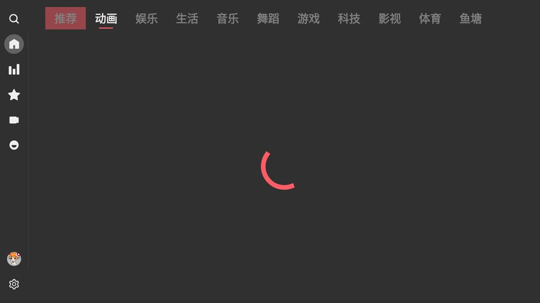

# ACAC


> **本仓库是 [xiaye13579/ACAC](https://github.com/xiaye13579/ACAC) 的 fork，额外包含一个修复：**
> 官方 v1.0.3 在新版 A 站页面上，除「推荐」外的所有分区都空列表（一直转圈）。
> 原因与修复方案见 **[docs/FIX.md](docs/FIX.md)**，补丁源码在 [`patch/`](patch)，一键构建用 [`scripts/build.sh`](scripts/build.sh)。

#### 一个第三方AcFun TV和Pad客户端，仅供学习与交流使用。该应用仅作为个人兴趣开发，应用没有任何破解行为，只是对于A站已有的API进行封装，所有数据来自于A站官方API，本人不对内容负责。应用通过firebase和appcenter收集的数据包括用户设备相关信息，以及崩溃日志，不会收集你的个人信息。
#### A third-party AcFun client for TV &amp; Pad, For learning and communication only. This application is developed as a personal interest. ACAC does not have any cracking behavior, but only encapsulates the existing API of AcFun. All data comes from the official API of AcFun. I am not responsible for the content. The data collected by the app through firebase and appcenter includes user device information and crash logs, and your personal information will not be collected.

---

## 分区空白修复（v1.0.4-fix）

### 现象

官方 v1.0.3 装上电视/盒子后，只有「推荐」有内容，动画 / 娱乐 / 生活 / 音乐 / 舞蹈 / 游戏 / 科技 / 影视 / 体育 / 鱼塘 全部停在加载圈。

| 修复前 | 修复后 |
|---|---|
|  |  |

### 原因

App 的分区页靠**抓网页 HTML 解析**，不调用官方 API：

```
GET https://www.acfun.cn/v/list{cid}/index.htm     # 旧版频道页
解析 div.channel-channel-module / div.video-item
```

A 站已把频道页改成 Vue 单页应用，这两个 DOM 类名在返回的 HTML 里出现 **0 次**（实测 200 / 约 780 KB，数据全在 `window.__INITIAL_STATE__` 的 JSON 里）。解析结果恒为空数组 → 分区全空。推荐页走的是 `?ajaxpipe=1` 分片接口，那个仍返回旧版 HTML，所以没坏。

**不是账号、网络或设备问题。**

### 修复方式

不动任何原业务代码，只把 `NetworkManager` 里两个取数方法的实现替换成一行转发，指向新增的 `com.acac.fix.Patch`：

| 原方法 | 转发到 |
|---|---|
| `getCategory(int, o9.a)` | `Patch.category(int, o9.a)` |
| `getCategoryDetail(int, int, o9.a)` | `Patch.categoryDetail(int, int, o9.a)` |

`Patch` 改调 A 站现行接口：

```
POST https://www.acfun.cn/rest/pc-direct/channel/resource/query/match
     sortField=rankScore&channelId={cid}&page={n}
```

返回 `{result:0, total, feed:[30], channelInfo:{}}`，字段为 `title` / `dougaId` / `coverUrl` / `viewCount` / `danmakuCount` / `durationMillis` / `createTimeMillis` / `user.name`
（是 `title` 和 `user.name`，不是 `contentTitle` / `userName`）。

组装回 App 原有的 `HomeRecommendItem` + `AcContent`（viewType 2 = 分区块标题，viewType 1 = 视频卡）并在主线程回调，因此列表、卡片、点击跳转、播放、弹幕全部沿用原逻辑。

细节见 **[docs/FIX.md](docs/FIX.md)**。

### 构建

```bash
export SRC_APK=/path/to/ACAC_API19_v1.0.3.apk      # 官方原始包
export APKTOOL_JAR=/path/to/apktool_2.x.jar
export BUILD_TOOLS=$ANDROID_HOME/build-tools/34.0.0
export JAVA_HOME=/path/to/jdk11+                    # 跑 apktool / d8 / apksigner
export JAVA8_HOME=/path/to/jdk8                     # javac，target 1.8
bash scripts/build.sh
# → dist/ACAC_API19_1.0.4-fix.apk
```

流程：`apktool d` → `patch_smali.py` → `apktool b` → `javac` → `d8` → 注入 `classes2.dex` → `zipalign` → `apksigner`。

### 安装注意

修复包用自签证书，与官方签名不同，**无法覆盖安装**：

```bash
adb uninstall com.xx.afaf     # 会清掉登录态和观看记录
adb install -r dist/ACAC_API19_1.0.4-fix.apk
```

验证解析是否成功：

```bash
adb logcat -s ACACFIX:*       # 每次请求打印 cid / page / 条目数
```

### 已知限制

- 分区只取 `sortField=rankScore`（热度）第一页，30 条/页，翻页正常；没有「最新」和时间范围筛选（原 App 界面也没有这些控件）。
- A 站若再改接口路径或字段，只需改 `patch/src/com/acac/fix/Patch.java` 的 `API` 常量与 `toContent()` 映射，重跑 `scripts/build.sh`。

### 免责声明

本仓库只包含**补丁源码、构建脚本和说明文档**，不包含官方 APK 或修改后的 APK 二进制。所有改动仅用于在自有设备上修复旧版本客户端的可用性，不涉及任何付费内容或会员权限。应用与内容版权归 AcFun 及原作者所有，请勿用于商业用途。
