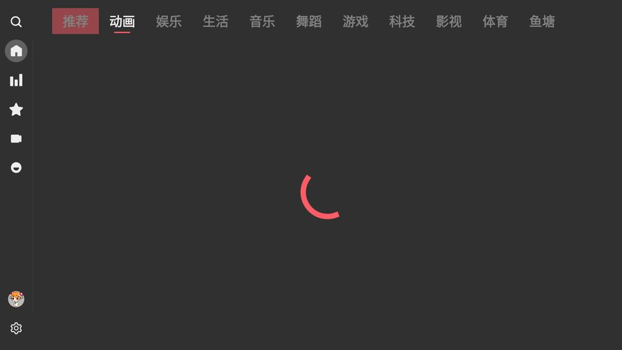

# 分区空白问题分析与修复（v1.0.3 → v1.0.4-fix）

测试设备：海信 VIDAA TV（Android 8.0 / API 26）· 包名 `com.xx.afaf` · 原始版本 v1.0.3（versionCode 5）

## 一、现象

打开 App 后只有「推荐」标签有内容；动画 / 娱乐 / 生活 / 音乐 / 舞蹈 / 游戏 / 科技 / 影视 / 体育 / 鱼塘 十个分区全部空白，一直转圈。



## 二、根因

已在真机上双向验证（抓 logcat + 直接请求站点）：

1. 这是 AcFun 的第三方 TV 客户端，**分区页不调用官方 API，而是抓网页 HTML 再按 DOM 类名解析**。
2. 「推荐」走首页分片接口，该接口目前仍返回旧版 HTML 片段，所以正常：

   ```
   GET https://www.acfun.cn/?pagelets=pagelet_douga,pagelet_life,...&reqID=0&ajaxpipe=1
   ```

3. 分区走旧版频道页：

   ```
   GET https://www.acfun.cn/v/list{cid}/index.htm
   ```

   解析器固定依赖 `div.channel-channel-module`（分区块）与 `div.video-item` / `div.module-title`（视频卡）。

4. A 站已把频道页改成 **Vue 单页应用**。实测该 URL 返回 200、约 780 KB，但：

   ```
   channel-channel-module : 0 次
   video-item             : 0 次
   ```

   页面数据全部内嵌在 `window.__INITIAL_STATE__` 的 JSON 里，HTML 里根本没有卡片节点。

   → 解析结果恒为空数组 → 每个分区都空白。

结论：**不是账号、网络或设备问题，是站点改版导致旧解析逻辑失效。**

## 三、现行接口（从 A 站前端 bundle 逆向得到）

现行频道页对应的 XHR 接口：

| 用途 | 接口 |
|---|---|
| 分区视频列表（主要用这个） | `POST /rest/pc-direct/channel/resource/query/match`　body：`sortField=rankScore&channelId={cid}&page={n}` |
| 首页区块 | `GET /rest/pc-direct/page/getBlocksByCid?cid={cid}` |
| 区块内容 | `GET /rest/pc-direct/page/getModulesByBlockId?blockId={id}` |
| 热词 | `GET /rest/pc-direct/tag/getHotTag?channelId={cid}` |
| 排行榜 | `POST /rest/pc-direct/rank/channel` |

实测 `channel/resource/query/match`：

```json
{"result":0,"total":10000,"feed":[ 30 条 ],"channelInfo":{...}}
```

单个 feed 元素的字段：

| 字段 | 说明 |
|---|---|
| `title` | 标题（**不是** `contentTitle`） |
| `dougaId` | 稿件 id，用于拼 `https://www.acfun.cn/v/ac{dougaId}` |
| `coverUrl` | 封面 |
| `viewCount` / `danmakuCount` | 播放 / 弹幕数 |
| `durationMillis` | 时长（毫秒）；为空时取 `videoList[0].durationMillis` |
| `createTimeMillis` | 发布时间 |
| `user.name` | UP 名（**不是** `userName`） |

> 第一版补丁用了 `contentTitle` / `userName`，结果卡片有封面但标题与 UP 名为空——这是最容易踩的坑。

频道 cid：动画 1、娱乐 60、生活 201、音乐 58、舞蹈 123、游戏 59、科技 70、影视 68、体育 69、鱼塘 125、番剧 155。文章区不涉及。

## 四、补丁实现

原则：**不修改任何原有业务代码**，只换数据来源。

1. `apktool d` 反编译，将 `smali/com/xx/afaf/network/NetworkManager.smali` 中两个方法的实现整体替换为一行转发（由 `scripts/patch_smali.py` 幂等完成）：

   | 原方法 | 转发到 |
   |---|---|
   | `getCategory(ILo9/a;)V` | `Patch.category(ILo9/a;)V` |
   | `getCategoryDetail(IILo9/a;)V` | `Patch.categoryDetail(IILo9/a;)V` |

   方法签名与泛型注解保留原样，只改方法体。

2. 新增 `com.acac.fix.Patch`（纯 Java，零第三方依赖）：

   - `HttpURLConnection` POST 上表接口，`org.json` 解析；
   - 组装 App 原有的 `HomeRecommendItem` + `AcContent`：`viewType=2` 是分区块标题行，`viewType=1` 是视频卡；
   - 回调切回主线程 `Handler(Looper.getMainLooper()).post(...)`，与原 Retrofit 回调的线程模型一致；
   - 卡片 `url` 设为 `https://www.acfun.cn/v/ac{dougaId}`，复用原有的点击跳转逻辑；
   - 时长 / 播放 / 弹幕 / 日期按中文习惯格式化（`mm:ss`、`1.2万`、`1.1亿`、`MM-dd`）。

3. 标题行的 `titleId` 传 `100000 + cid`。原逻辑里 `titleId` 会被 `b9.a` 映射成顶部标签索引，点标题会「原地切标签」；加上偏移量后不再命中映射，于是点标题 / 「更多」会正常打开 `CategoryDetailFragment` 的可翻页列表（每页 30 条）。

4. 构建：`javac`(target 1.8) → `d8 --min-api 19` → 生成 `classes2.dex` 注入 APK（apktool 产出的 `classes.dex` 保持不变）→ `zipalign -p 4` → `apksigner`（v1 + v2，自签证书）。

5. 签名与官方不同，必须先卸载旧包再安装，否则 `INSTALL_FAILED_UPDATE_INCOMPATIBLE`。卸载会清掉登录态与观看记录。

## 五、验证结果（真机）

| 项 | 结果 |
|---|---|
| 动画(1) / 娱乐(60) / 生活(201) / 音乐(58) / 舞蹈(123) / 游戏(59) / 科技(70) / 影视(68) / 体育(69) / 鱼塘(125) | 全部返回 30~31 条并正常渲染，无异常日志 |
| 卡片信息 | 封面、标题、UP 名、播放量、弹幕数、时长、日期齐全 |
| 标题行 → 分区详情 | 正常打开分页列表（page=1 30 条、page=2 29 条） |
| 视频详情页 | 正常（标题 / UP / 分P / 相关推荐） |
| 播放 + 弹幕 | 正常 |


## 六、复现步骤

```bash
# 1. 准备：原始 v1.0.3 APK、apktool 2.x、Android build-tools、JDK8 + JDK11+
export SRC_APK=/path/to/ACAC_API19_v1.0.3.apk
export APKTOOL_JAR=/path/to/apktool.jar
export BUILD_TOOLS=$ANDROID_HOME/build-tools/34.0.0
export JAVA_HOME=/path/to/jdk11+
export JAVA8_HOME=/path/to/jdk8

# 2. 构建
bash scripts/build.sh            # → dist/ACAC_API19_1.0.4-fix.apk

# 3. 安装（签名不同，必须先卸载）
adb uninstall com.xx.afaf
adb install -r dist/ACAC_API19_1.0.4-fix.apk

# 4. 观察日志
adb logcat -s ACACFIX:*
```

日志样例：

```
I/ACACFIX: category cid=201 page=1 title=true
I/ACACFIX: cid=201 page=1 items=31
```

## 七、已知限制

- 分区固定 `sortField=rankScore`（热度），每页 30 条，翻页正常；未做「最新」/ 时长 / 日期筛选 UI（原 App 界面也没有这些控件）。
- 未改动「推荐」「文章区」等其它入口的行为。
- A 站再次改接口时，只需修改 `patch/src/com/acac/fix/Patch.java` 中的 `API` 常量与 `toContent()` 字段映射，重跑 `scripts/build.sh`。
